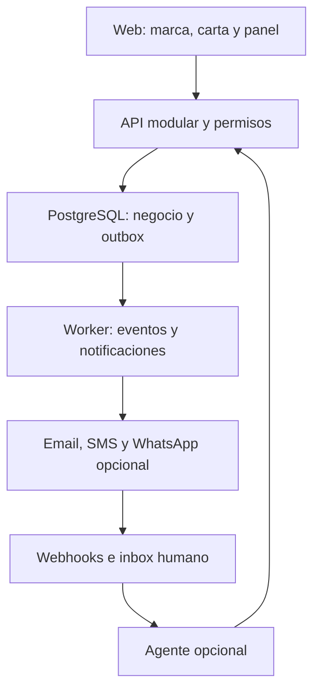

# Konnectia — Blueprint funcional, técnico y de negocio

**Productos:** EasyOrder y EasyAgenda  
**Mercado inicial:** negocios locales de Canarias, España  
**Versión:** 1.1 — 7 de octubre de 2026  
**Estado:** propuesta para evaluación; no constituye una implementación ni una decisión comercial definitiva.  
**Uso previsto:** documento autónomo para contrastar la idea, definir el MVP y solicitar una segunda opinión a Claude Co-work.

## 1. Decisión principal

Konnectia debe ser una marca de soluciones digitales para negocios de servicios. Su primer producto, **EasyOrder by Konnectia**, permitirá publicar cartas personalizadas, recibir pedidos y gestionarlos desde un panel. El segundo producto previsto, **EasyAgenda by Konnectia**, estará orientado a reservas de servicios en peluquerías, centros de belleza y spas.

**EasyOrder debe funcionar completamente sin agente de WhatsApp.** Email será el canal de notificación inicial recomendado; SMS, notificaciones automáticas de WhatsApp y agente conversacional serán capacidades independientes que se podrán contratar y activar posteriormente.

La inspiración de Toast Local se mantiene para descubrimiento de restaurantes, carta y pedido web. La página consultada ofrece búsqueda por ubicación/tipo de comida y modalidades como delivery y pickup [S1]. El valor diferencial propuesto es una operación sencilla para pequeños negocios, identidad propia y automatización opcional. No se debe presentar la plataforma como un proveedor de reparto ni prometer tráfico o ventas que aún no se han demostrado.

Se recomienda una landing corporativa, productos en subdominios y una base tecnológica compartida. La prioridad comercial será validar EasyOrder en una zona concreta antes de construir EasyAgenda o extender el marketplace a todas las islas.

La plataforma tendrá **RBAC configurable**: creación de usuarios y roles, asignación de permisos por acción y alcance, y módulos habilitados únicamente cuando la organización tenga derecho de uso y el usuario tenga permiso. Auditoría de operaciones y logs de errores permitirán reconstruir lo sucedido y dar soporte con trazabilidad.

## 2. Alcance de este documento y calidad de la evidencia

Este documento integra el análisis previo y las cinco nuevas solicitudes: email, SMS, agente opcional, acceso social y estructura de marca/productos. También contrasta el DDL y los workflows n8n adjuntos de La Isla.

La versión 1.1 incorpora además administración de usuarios/roles/permisos, autorización de módulos por contratación y RBAC, y especificaciones de auditoría y diagnóstico de errores.

Se distinguen tres tipos de contenido:

- **Observado:** estructura de archivos adjuntos y capacidades descritas por fuentes oficiales consultadas.
- **Recomendado:** decisiones de arquitectura, experiencia, fases y alcance propuestas aquí.
- **Hipótesis:** precios, costos, objetivos de adopción y disposición a pagar; deberán validarse con negocios reales.

Los dominios utilizados son ejemplos de organización, no una confirmación de disponibilidad, propiedad ni ausencia de conflictos de marca. Los nombres EasyOrder y EasyAgenda son nombres de trabajo.

No se han desplegado sitios, modificado workflows, migrado datos ni comprado dominios. El objetivo actual es obtener un diseño evaluable.

## 3. Problema y propuesta de valor

### 3.1 Problema que se propone resolver

Hipótesis a contrastar: algunos negocios gestionan cartas desactualizadas, pedidos por múltiples canales y consultas repetitivas sin un registro común. Esto puede generar errores de precios, omisiones, dificultad para saber qué pedido corresponde a qué conversación y dependencia de atención manual.

EasyOrder propone centralizar carta, pedido y estado operativo, conservando el control del negocio sobre su marca y sus canales. EasyAgenda aplicaría después la misma filosofía a disponibilidad y reservas.

### 3.2 Beneficios esperados

| Beneficiario | Beneficio propuesto | Cómo comprobarlo |
|---|---|---|
| Restaurante | Carta y precios actualizables sin rehacer PDFs | Tiempo necesario para editar y publicar un producto |
| Restaurante | Pedidos estructurados y trazables | Porcentaje de pedidos sin corrección manual |
| Restaurante | Operación sin contratar IA | Uso del panel y pedidos completados con agente desactivado |
| Cliente final | Ver opciones, extras y total antes de confirmar | Conversión de carrito a pedido |
| Cliente final | Elegir acceso como invitado o con cuenta | Abandono del checkout por paso |
| Plataforma | Ingreso recurrente y complementos medibles | Margen de contribución, renovación y consumo |
| Negocio de belleza futuro | Reservas según disponibilidad real | Reducción de conflictos y ausencias en piloto EasyAgenda |

Son beneficios a medir; no resultados garantizados.

### 3.3 Posicionamiento propuesto

- **Konnectia:** «Soluciones digitales para conectar tu negocio con sus clientes».
- **EasyOrder:** «Tu carta, tus pedidos y tu atención en una sola plataforma».
- **EasyAgenda:** «Tus servicios y reservas, organizados en un solo lugar».

La IA debe presentarse como una opción que resuelve tareas concretas, no como condición para utilizar la plataforma.

## 4. Arquitectura de marca

### 4.1 Recomendación: productos respaldados por una marca principal

Utilizar **EasyOrder by Konnectia** y **EasyAgenda by Konnectia**. Konnectia aporta confianza, soporte y continuidad; cada producto comunica una necesidad específica.

Se adopta la escritura **Konnectia**, indicada en la solicitud actual. La variante anterior «Konnecttia» debe dejar de usarse en documentos y propuestas una vez elegida definitivamente la identidad.

| Estrategia | Ventajas | Contras | Recomendación |
|---|---|---|---|
| Todo se llama Konnectia y se organiza por módulos | Una sola identidad comercial | Puede resultar poco claro para cada sector | Útil para el panel común, menos para vender cada solución |
| EasyOrder y EasyAgenda como marcas independientes | Mensaje muy enfocado | Duplica inversión en reputación y marketing | Evitar al inicio |
| EasyOrder/EasyAgenda by Konnectia | Equilibra especialización y confianza común | Requiere reglas consistentes de nombres y diseño | Opción recomendada |

### 4.2 Reglas de identidad

1. Logo y tipografía corporativos comunes; acento visual distinto por producto.
2. Mensajes enfocados en pedidos para EasyOrder y reservas para EasyAgenda.
3. Soporte, políticas y facturación coherentes bajo Konnectia, según la entidad legal que se defina.
4. En la página de un restaurante predomina su marca; «Tecnología de Konnectia» puede ser discreto y configurable según el plan.
5. No utilizar marcas, textos ni diseños de Toast como identidad propia. Se reutiliza la idea de experiencia, no sus activos.
6. No anunciar EasyAgenda como disponible si solo existe el concepto: mostrar «Próximamente» y permitir registro de interés.

### 4.3 Validación pendiente de nombres

Antes de invertir en identidad o dominios: investigar coincidencias exactas y similares de Konnectia, EasyOrder y EasyAgenda; revisar OEPM, EUIPO, dominios y perfiles sociales; evaluar clases de productos/servicios con asesoría de marcas. Registrar un dominio no equivale a disponer de derechos sobre la marca. La OEPM ofrece un buscador oficial para la investigación inicial [S7].

Si los nombres de producto resultan poco diferenciables o tienen conflictos, valorar nombres más distintivos manteniendo la marca principal. No afirmar su disponibilidad sin comprobarla.

## 5. Dominio, rutas y separación de audiencias

### 5.1 Organización recomendada

Usar el dominio corporativo para presentar el ecosistema; subdominios para operar cada producto. Las siguientes URLs son ilustrativas:

| URL propuesta | Función | Momento |
|---|---|---|
| `konnectia.com` | Landing de marca, soluciones y contacto comercial | MVP |
| `konnectia.com/productos/easyorder` | Presentación comercial de EasyOrder | MVP |
| `konnectia.com/productos/easyagenda` | Concepto y lista de interés de EasyAgenda | MVP de marca |
| `easyorder.konnectia.com` | Producto: directorio, páginas y acceso al panel | MVP |
| `easyorder.konnectia.com/local/lanzarote/playa-honda` | Descubrimiento por isla y localidad | Piloto con catálogo real |
| `easyorder.konnectia.com/r/la-isla` | Carta y pedidos del restaurante | MVP |
| `easyorder.konnectia.com/app` | Panel privado del negocio | MVP |
| `easyagenda.konnectia.com` | Producto futuro de reservas | Después de validación |
| `pedidos.restaurante-ejemplo.com` | Dominio del restaurante conectado a EasyOrder | Fase posterior |
| `cuenta.konnectia.com` | Centro de cuenta y acceso común | Cuando haya más de un producto operativo |

**No crear un subdominio por restaurante en la primera versión.** Las rutas `/r/[slug]` reducen trabajo de DNS, certificados y callbacks de autenticación. Los subdominios y dominios propios por negocio pueden añadirse después.

### 5.2 Alternativas

| Alternativa | Pros | Contras |
|---|---|---|
| Todo bajo `konnectia.com/easyorder` y `/easyagenda` | Navegación y medición centralizadas; despliegue inicial simple | Separar aplicaciones después puede requerir proxy y coordinación de rutas |
| Productos en subdominios | Identidad corporativa común; despliegues y equipos separables | SEO, sesiones y analítica requieren configuración por host |
| Dominio independiente por producto | Mayor autonomía comercial | Más mantenimiento, inversión de marca y complejidad de acceso |

Para este proyecto se recomiendan subdominios de producto y páginas comerciales en el dominio principal. No se promete ventaja automática de SEO; la calidad del contenido, enlaces y estructura local será decisiva.

### 5.3 Sesiones y dominios

Compartir identidad no significa compartir indiscriminadamente cookies. Diseñar acceso central mediante redirecciones OIDC y sesiones locales por aplicación, cookies seguras y permisos por producto. Un dominio propio de restaurante no recibe automáticamente las cookies de Konnectia; requerirá un flujo seguro de acceso o checkout como invitado.

Resolver restaurante y tenant desde rutas/hosts registrados en el servidor. No confiar en un encabezado o `tenant_id` enviado por el navegador como prueba de autorización.

## 6. Landing corporativa Konnectia

### 6.1 Objetivo y público

La landing sirve para captar **negocios**, explicar los productos y generar demos. El marketplace de EasyOrder sirve para **consumidores** que quieren comprar comida. Los dos recorridos deben ser claros.

### 6.2 Funcionalidades y contenido

| Bloque | Contenido | Acción |
|---|---|---|
| Encabezado | Marca, productos, cómo funciona, contacto, acceso | Navegar o iniciar sesión |
| Portada | Propuesta de valor y sectores | «Solicitar demo» / «Ver EasyOrder» |
| Productos | EasyOrder disponible según fase; EasyAgenda próximamente | Acceso al producto o lista de interés |
| Casos de uso | Restaurantes, bares, peluquerías y spas | Identificar la solución relevante |
| Cómo funciona | Alta, configuración, publicación y operación | Entender el esfuerzo de adopción |
| Beneficios | Control de marca, registro operativo y canales opcionales | Evaluar encaje |
| Planes | Plan base y complementos, con condiciones visibles | Solicitar propuesta o contratar cuando esté disponible |
| FAQ | IA opcional, costos de mensajes, migración de carta, soporte | Resolver objeciones |
| Contacto/demo | Nombre, negocio, email, localidad y producto de interés | Capturar oportunidad comercial |
| Pie legal | Identidad del prestador, privacidad, condiciones y cookies | Acceder a información obligatoria |

La landing deberá permitir edición de contenido, tener formularios con validación y protección contra abuso, SEO básico, diseño móvil y medición de conversiones conforme a la configuración de privacidad. El formulario de demo no debe dar consentimiento de marketing por defecto.

Si se muestra un caso de La Isla, obtener autorización para utilizar nombre, capturas y resultados. No crear testimonios, cifras de clientes ni ahorros ficticios.

## 7. Productos y límites del ecosistema

### 7.1 EasyOrder — prioridad de construcción

Clientes iniciales: restaurantes y bares que quieran carta y pedidos web, con recogida o entrega gestionada por el propio negocio. Bares con pedido en mesa mediante QR pueden ser una extensión; dividir cuentas, abrir comandas y gestionar mesas no forman parte del primer MVP.

Capacidades centrales: carta, carrito, checkout, panel de pedidos, email y directorio local sencillo. SMS y WhatsApp se integran mediante módulos opcionales.

### 7.2 EasyAgenda — visión funcional futura

| Área | Funcionalidades propuestas |
|---|---|
| Negocio | Perfil, sedes, horarios, cierres y marca |
| Servicios | Nombre, duración, precio, anticipación y tiempo entre citas |
| Personal y recursos | Profesionales, cabinas, equipos y asignación |
| Disponibilidad | Horarios, bloqueos, excepciones y prevención de doble reserva |
| Reserva | Elegir servicio, profesional, horario y datos del cliente |
| Operación | Confirmar, reprogramar, cancelar y marcar asistencia/ausencia |
| Comunicación | Confirmaciones por email; SMS y WhatsApp opcionales |
| Futuro | Depósitos, lista de espera y agente de reservas opcional |

La reserva deberá bloquear recursos en una transacción y tratar cambios simultáneos. No reutilizar pedidos como si fueran citas: son dominios diferentes.

No incluir historiales clínicos, diagnósticos ni datos sensibles de salud en el MVP de EasyAgenda. Si el negocio requiere ese tipo de información, analizar un alcance específico antes de recogerla.

### 7.3 Qué compartir y qué separar

Compartir: organizaciones, acceso, roles, planes, complementos, notificaciones, medios, auditoría y configuración general de marca.

Separar: catálogo alimentario, pedidos y reparto de EasyOrder; servicios, profesionales, disponibilidad y reservas de EasyAgenda. Un negocio puede contratar ambos productos, pero eso no autoriza mezclar datos de clientes o consentimientos.

## 8. Modelo multitenant y permisos

### 8.1 Conceptos

- **Tenant:** organización contratante; puede tener uno o varios negocios/sedes.
- **Producto contratado:** EasyOrder o EasyAgenda, con estado propio.
- **Restaurante/negocio:** entidad comercial dentro del tenant.
- **Sede:** ubicación con horario, operativa y zona de servicio.
- **Usuario:** identidad que puede pertenecer a varias organizaciones con distintos permisos.
- **Cliente final:** perfil de compra o reserva ligado al negocio; puede tener o no una cuenta de acceso.

Una suscripción de restaurante y una cuenta de consumidor son conceptos distintos. Iniciar sesión con Google no convierte a un consumidor en administrador.

### 8.2 Roles iniciales y RBAC configurable

**RBAC (Role-Based Access Control)** asigna permisos mediante roles. La siguiente tabla contiene roles de referencia; el sistema también debe permitir que cada organización cree roles propios, como «Cajero», «Encargado de carta» o «Consulta de pedidos».

| Rol | Permisos previstos |
|---|---|
| Administrador de plataforma | Alta y soporte de tenants; acceso excepcional a datos, justificado y auditado |
| Propietario | Configuración, membresías, suscripción y operación de su organización |
| Responsable | Carta, horarios y operación; facturación si se delega |
| Personal | Pedidos y estados de sedes autorizadas |
| Cliente final | Sus propios pedidos y datos; sin acceso al panel del negocio |
| Agente/worker | Solo acciones habilitadas, sobre tenant y recursos autorizados |

MVP: una sede operativa por restaurante, dejando el modelo preparado para varias sin construir todavía toda la gestión multisede.

### 8.2.1 Administración de usuarios y roles

El propietario o administrador autorizado del tenant podrá:

1. Invitar usuarios por email, crear su membresía y consultar el estado de la invitación. La identidad de acceso se crea mediante el sistema de autenticación, sin exponer contraseñas al administrador.
2. Activar, suspender o retirar membresías de su organización. Retirar una membresía no elimina la cuenta global ni los accesos que tenga en otros negocios.
3. Crear, editar y archivar roles personalizados con nombre, descripción y selección de permisos del catálogo.
4. Asignar uno o varios roles a un usuario y limitar su alcance a negocios/sedes autorizados.
5. Consultar el acceso efectivo de un usuario y su origen: rol, alcance y estado del módulo.
6. Revocar accesos y actualizar las autorizaciones vigentes sin esperar a que el usuario cierre sesión; invalidar cachés de permisos y comprobar cambios en API/workers.

Los roles de propietario y plataforma son protegidos: no se eliminan libremente ni se deja una organización sin propietario activo. Transferir propiedad requiere un proceso explícito y auditado. Un administrador de restaurante no puede crear ni asignar un rol de plataforma.

El catálogo de permisos lo define la plataforma por módulo. Crear un rol no permite inventar permisos, comprar un módulo ni habilitar funciones fuera del contrato. La delegación debe impedir autoelevar privilegios o conceder facultades superiores a las autorizadas para quien administra roles. Cambiar un rol informa cuántos usuarios se verán afectados y deja registro del antes/después.

Para el MVP, combinar permisos concedidos por roles mediante unión, con denegación por defecto y límites obligatorios de tenant/sede, contratación y reglas de negocio. Evitar inicialmente excepciones directas por usuario y reglas contradictorias de allow/deny; si se necesitan, diseñarlas como ampliación con precedencia explícita.

### 8.2.2 Permisos por acción y recurso

| Módulo | Permisos ilustrativos | Separación requerida |
|---|---|---|
| Usuarios | `users.view`, `users.invite`, `users.manage`, `users.suspend` | Consultar no permite cambiar membresías |
| Roles | `roles.view`, `roles.create`, `roles.edit`, `roles.assign` | Asignar un rol no autoriza elevar privilegios |
| Carta | `catalog.view`, `catalog.create`, `catalog.edit`, `catalog.publish` | Editar borradores puede separarse de publicar |
| Pedidos | `orders.view`, `orders.edit`, `orders.change_status`, `orders.cancel`, `orders.export` | Ver un pedido no permite modificarlo/cancelarlo |
| Configuración | `settings.view`, `settings.edit` | Cambios limitados al tenant/sede autorizados |
| Suscripción | `billing.view`, `billing.manage` | Acceso financiero independiente de pedidos |
| Inventario futuro | `inventory.view`, `inventory.manage`, `inventory.adjust`, `inventory.export` | Ver existencias no permite registrar ajustes |
| Auditoría | `audit.view`, `audit.export` | Consulta/exportación controladas; sin edición del historial |
| Diagnóstico | `diagnostics.view`, `diagnostics.manage` | Resumen operativo separado de logs técnicos sensibles |

La visualización pública de una carta publicada no requiere el mismo permiso que visualizar su administración privada. Tampoco asignar `orders.view` a un cliente final: su acceso se limita a sus propios pedidos mediante reglas de propiedad del recurso.

Además del permiso, verificar que el recurso pertenece al tenant y a una sede accesible, y que la operación es válida para su estado. Un permiso de edición no autoriza cambiar cualquier dato de cualquier organización.

### 8.2.3 Matriz ilustrativa de roles

| Rol del negocio | Ver pedidos | Editar/cancelar pedidos | Editar/publicar carta | Gestionar usuarios/roles | Ver auditoría |
|---|---|---|---|---|---|
| Propietario | Sí | Sí, según estado | Sí | Sí, dentro de su tenant | Sí |
| Operador de pedidos | Sí | Solo acciones asignadas | No | No | No |
| Responsable de carta | No, salvo asignación | No | Sí | No | No |
| Consulta | Sí | No | Solo consulta si se concede | No | No |

Son plantillas configurables, no una lista cerrada. El inventario se excluye de esta matriz inicial porque su desarrollo no forma parte del MVP base; cuando exista, se incorporará al catálogo de permisos.

### 8.3 Aislamiento desde el inicio

Se recomienda PostgreSQL compartido con `tenant_id` en las entidades privadas, autorización en backend, claves foráneas coherentes con tenant y **RLS desde el MVP de producción**. Esto corrige la propuesta anterior que dejaba RLS para más adelante.

PostgreSQL permite políticas por fila, pero propietarios de tablas y roles privilegiados pueden evitarlas [S2]. El rol normal de aplicación no será superusuario, propietario ni `BYPASSRLS`; las tareas administrativas tendrán un camino separado. El contexto del tenant se establecerá desde identidad confiable dentro de cada transacción, sin filtrarse entre conexiones del pool.

El directorio público expondrá únicamente información publicada mediante endpoints/proyecciones limitadas; no dará acceso anónimo a pedidos, teléfonos, direcciones o conversaciones. Aislar también cachés, archivos, colas y sesiones conversacionales, no solo SQL.

### 8.4 Sistema de módulos y habilitación por contrato

La modularidad tendrá dos dimensiones: módulos técnicos con responsabilidades claras y módulos funcionales que pueden formar parte de un plan o contratarse como complemento. No todo módulo técnico necesita venderse por separado; identidad, RBAC y auditoría esencial son infraestructura base.

Registrar un catálogo de módulos con código estable, producto, descripción, disponibilidad, dependencias y capacidades. Registrar por tenant sus derechos de uso, estado, límites y activación operativa. Esta configuración debe reutilizar el sistema de suscripciones/capacidades de la sección 12, evitando dos fuentes de verdad de contratación.

Ejemplo: `easyorder.inventory` será un módulo futuro. Si el restaurante no lo ha contratado, un usuario con `inventory.view` no puede abrirlo. Si está contratado, pero el usuario no tiene permiso, tampoco puede acceder. Tener permisos no activa una licencia y pagar una licencia no concede permisos a todos los empleados.

**Regla de acceso:** módulo disponible y operativo + derecho de uso vigente del tenant + membresía/identidad autorizada + permiso para la acción + alcance del recurso + reglas y cuota aplicables.

| Derecho de uso del módulo | Permiso del usuario | Resultado |
|---|---|---|
| No | No | Sin acceso |
| No | Sí | Sin acceso; el permiso no sustituye la contratación |
| Sí | No | Sin acceso para ese usuario |
| Sí | Solo visualizar | Puede consultar; no editar, ajustar ni exportar salvo permiso específico |
| Sí | Visualizar y editar | Puede ejecutar esas acciones en su alcance y según reglas |

### 8.5 Comportamiento de módulos no habilitados

- Ocultar o bloquear navegación, pantallas y acciones operativas para quien no tenga acceso.
- El propietario autorizado puede ver una ficha comercial de un módulo disponible, sin acceder a sus datos ni ejecutar operaciones antes de contratarlo.
- Validar autorización en API, workers, exportaciones, integraciones y tools del agente; acceder por URL directa no evita el control.
- No ejecutar tareas facturables de un módulo suspendido/cancelado. Reevaluar trabajos en cola antes de ejecutarlos y registrar si se omiten.
- Definir dependencias: agente necesita canal configurado; inventario futuro podría necesitar catálogo, pero nunca hacer obligatorio inventario para recibir pedidos básicos.
- Definir política contractual de suspensión, período de gracia y acceso histórico. Al cancelar, no borrar datos automáticamente: nuevas operaciones quedan bloqueadas y lectura/exportación histórica se permiten solo si lo contempla la política y el usuario tiene permisos.
- Activar/desactivar un módulo no implica desplegar código nuevo por tenant ni crear otra base de datos.

RBAC y contratación son obligatorios desde el MVP; **inventario es un ejemplo de extensión futura**, no una ampliación inmediata del alcance de desarrollo.

## 9. Alcance funcional de EasyOrder

Prioridades: **P0** indispensable para el MVP base; **P1** primera ampliación o módulo opcional; **P2** expansión posterior. P1 no significa que el servicio sea obligatorio al contratar.

| ID | Funcionalidad | Prioridad | Criterio de aceptación principal |
|---|---|---|---|
| EO-01 | Alta manual de tenant, restaurante y propietario | P0 | El propietario accede únicamente a su organización |
| EO-02 | Perfil público y branding básico | P0 | Logo, portada y colores se publican tras validación |
| EO-03 | Categorías, productos, variantes y modificadores | P0 | Solo se admiten combinaciones y cantidades permitidas |
| EO-04 | Precios, disponibilidad y alérgenos | P0 | El cliente ve la información antes de confirmar |
| EO-05 | Horarios, cierres y pausa de pedidos | P0 | Checkout vuelve a validar apertura y aceptación |
| EO-06 | Carta móvil y búsqueda de productos | P0 | Funciona en móvil y con navegación por teclado |
| EO-07 | Carrito de un restaurante | P0 | No mezcla productos de negocios distintos |
| EO-08 | Recogida y entrega del restaurante | P0 | Se calcula costo y mínimo según sede/zona |
| EO-09 | Checkout como invitado | P0 | Se puede comprar sin Google ni cuenta registrada |
| EO-10 | Cuenta y acceso Google/email | P0 | Se autentica sin conceder permisos de negocio automáticamente |
| EO-11 | Creación de pedido con precios del servidor | P0 | Repetir la misma confirmación no crea dos pedidos |
| EO-12 | Panel y cambio de estados | P0 | Cada transición tiene actor, hora y validación |
| EO-13 | Seguimiento desde enlace seguro | P0 | Código público de pedido no basta para ver datos personales |
| EO-14 | Notificaciones email y en panel | P0 | Un fallo de email no pierde el pedido |
| EO-15 | Directorio simple por isla/localidad | P0 | Muestra solo negocios publicados y filtros reales |
| EO-16 | Exportación operativa limitada | P0 | Propietario exporta sus pedidos con permiso y auditoría |
| EO-17 | Complemento SMS | P1 | Solo envía con servicio activo, cuota y destinatario válido |
| EO-18 | WhatsApp manual mediante enlace | P1 | Abre conversación sin prometer automatización |
| EO-19 | Notificaciones automáticas WhatsApp | P1 | Canal habilitado y reglas del proveedor aplicadas |
| EO-20 | Agente WhatsApp y handoff humano | P1 | Activable y cancelable sin afectar el core |
| EO-21 | Importación de carta CSV/Excel | P1 | Previsualiza errores antes de publicar |
| EO-22 | Otros proveedores de acceso social | P2 | Solo proveedores soportados y demanda validada |
| EO-23 | Pagos online integrados | P2 | Confirmación por webhook verificado, no por redirección del navegador |
| EO-24 | Dominios propios y multisede avanzada | P2 | Host y recursos asociados al tenant correcto |
| EO-25 | Administración de usuarios y membresías | P0 | Invitar/suspender usuarios afecta solo a la organización autorizada |
| EO-26 | Roles personalizados y permisos RBAC | P0 | Se crean roles y se asignan acciones sin elevar privilegios |
| EO-27 | Habilitación de módulos por contrato y permiso | P0 | Sin derecho de uso o permiso, UI/API/workers rechazan operaciones |
| EO-28 | Auditoría de operaciones críticas | P0 | Se identifica quién hizo qué, sobre qué recurso y con qué resultado |
| EO-29 | Logs de errores y correlación de soporte | P0 | Un código de incidencia permite localizar la operación y su fallo |
| EO-30 | Inventario como módulo contratable futuro | P2 | Cuando se implemente, usa el mismo control de módulos y RBAC |

### 9.1 Branding y carta

Permitir plantillas controladas, logo, portada, color principal/secundario, descripción, redes y orden de categorías. Validar contraste de colores. Evitar un editor de páginas libre o código personalizado en el MVP.

Los modificadores deben modelar mínimo/máximo de opciones, obligatoriedad, incompatibilidades y precio adicional. No limitar el modelo a pizzas ni a un campo `is_pizza`. Los alérgenos aplicarán también a variantes y extras; no inferir «sin alérgenos» cuando falta información.

### 9.2 Horarios y delivery

Mantener `Atlantic/Canary` por sede, ventanas que cruzan medianoche, horarios partidos, festivos/excepciones y hora límite de pedidos. Guardar instantes en UTC con `timestamptz`; calcular apertura en la zona local.

Para delivery inicial, definir zonas manuales por localidad/código postal con tarifa y mínimo. Un código postal por sí solo puede ser demasiado amplio: el restaurante debe confirmar la dirección y la cobertura. Si no se puede determinar, informar «pendiente de validar» en lugar de prometer entrega. Radio y polígonos precisos podrán llegar después.

Geolocalización será opcional y no bloqueará la compra. El reparto lo organiza el restaurante; no se incluye red propia de repartidores ni seguimiento GPS.

### 9.3 Checkout y operación

Un carrito corresponde a un restaurante y sede. Cambiar de negocio solicita al cliente confirmar que reiniciará el carrito. El servidor vuelve a comprobar precios, disponibilidad, extras, apertura, mínimo y envío al confirmar.

Datos mínimos: nombre, contacto operativo elegido, modalidad y dirección si hay entrega. Email será recomendado para confirmaciones, con posibilidad de continuar mediante teléfono y seguimiento web si no se proporciona. No exigir WhatsApp instalado.

Separar «pedido recibido» de «pedido aceptado por el restaurante». Definir un tiempo de respuesta configurable y mostrar al cliente si continúa pendiente. Un pedido sin respuesta genera alerta al personal; no se acepta automáticamente salvo configuración y reglas explícitas.

MVP de pago: efectivo o tarjeta al recoger/entregar, según el negocio. Transferencias y comprobantes, si se habilitan, requieren revisión humana. Ninguna IA declara un pago confirmado porque recibió una imagen.

## 10. Inicio de sesión con Google y otras redes

### 10.1 Recomendación

Incluir Google y enlace seguro por email para cuentas, manteniendo checkout como invitado. En interfaz usar **«Continuar con Google»**, no «entrar a Gmail»: autenticar la cuenta no requiere acceso al correo del usuario.

Google documenta autenticación mediante OpenID Connect [S3]. Solicitar únicamente identidad y, si procede, email/nombre; no pedir permisos de Gmail, contactos o calendario para comprar comida.

Apple, Microsoft o Facebook podrán evaluarse por demanda en fases siguientes. «Redes sociales» no implica que Instagram o cualquier red sean proveedores adecuados de autenticación; cada integración debe verificarse.

### 10.2 Reglas de cuenta

- Utilizar identificador interno y combinación `issuer/provider + subject`; Google recomienda `sub` en lugar de email como identificador estable [S3].
- Un email de Google verificado no demuestra propiedad del teléfono o WhatsApp; verificar estos por separado antes de enlazar conversaciones o pedidos históricos.
- No fusionar automáticamente identidades porque el nombre o email coincidan. Requerir un proceso seguro de vinculación.
- Asociar invitados a cuentas posteriormente solo cuando se demuestre acceso al pedido/contacto.
- Una cuenta común podrá ver sus propios pedidos, pero cada negocio verá únicamente sus relaciones y operaciones autorizadas.
- Para personal: invitación, membresía y permisos de sede. MFA para propietarios y administradores antes de operación real.
- No compartir automáticamente preferencias de marketing ni historiales entre EasyOrder y EasyAgenda.

## 11. Notificaciones: email, SMS, WhatsApp y panel

### 11.1 Separar tres capacidades de WhatsApp

| Capacidad | Qué hace | Qué requiere | Relación con la IA |
|---|---|---|---|
| Enlace manual | Cliente abre WhatsApp del restaurante | Número y enlace configurados | Ninguna |
| Notificaciones automáticas | Envía eventos transaccionales | Integración oficial, canal y configuración | Ninguna |
| Agente conversacional | Consulta y actúa sobre pedidos mediante tools | Canal oficial, permisos, IA y handoff | Complemento de IA |

Contratar agente no será necesario para email, SMS, panel ni pedidos web. Puede existir una dependencia técnica del agente respecto a un canal WhatsApp activo, pero esa dependencia debe explicarse en la oferta comercial.

### 11.2 Matriz inicial de eventos

| Evento | Cliente | Restaurante | Regla recomendada |
|---|---|---|---|
| Pedido recibido | Pantalla/enlace web + email si está disponible | Panel con alerta; email de respaldo | No equivale a aceptación |
| Pedido aceptado/rechazado | Email; SMS/WhatsApp si se habilitan | Panel | Incluir referencia y próximo paso |
| Pedido listo | Canal preferido habilitado | Panel | Priorizarlo para recogida |
| Pedido en reparto | Canal habilitado, según configuración | Panel | No prometer hora exacta sin dato operativo |
| Cancelación o cambio relevante | Web + canal habilitado | Panel y alerta | Mostrar impacto en total/pago |
| Pedido sin atender | Estado web | Alerta en panel; email y SMS opcional | Evitar repetir alertas sin límite |
| Fallo de integración/cuota | Seguimiento web disponible | Panel y responsable | No afectar creación de pedidos |
| Cambio de suscripción | Email al propietario | Centro de cuenta | Separado de mensajes al consumidor |
| Reserva futura EasyAgenda | Confirmación y recordatorio | Calendario/panel | Reutiliza infraestructura, no lógica de pedidos |

En MVP, panel con alerta visual/sonora y actualización por polling breve o SSE. Considerar restricciones de sonido en navegadores y contar con instrucciones operativas claras. Web push podrá añadirse después; no es el SMS solicitado.

### 11.3 Email

Requisitos: plantillas por producto/idioma, identidad visible del restaurante, proveedor transaccional, dominio de envío verificado y SPF/DKIM/DMARC, cola, registro de resultado, tratamiento de rebotes y direcciones suprimidas. Un email aceptado por el proveedor no garantiza que esté en la bandeja de entrada.

Para empezar, enviar desde un dominio/subdominio controlado por Konnectia con nombre del restaurante y `Reply-To` autorizado. Enviar desde el dominio propio del negocio exige verificación adicional. Confirmar las capacidades del proveedor elegido antes de integrar.

### 11.4 SMS

El complemento SMS debe contemplar país, formato E.164, números de turistas, tipo de remitente, segmentos por longitud/codificación y presupuesto. No asumir que una notificación equivale a un único SMS facturable.

Permitir eventos seleccionados, límites por tenant, alertas de consumo y bloqueo de sobrecostos salvo autorización del propietario. Evitar textos largos y datos personales innecesarios. No permitir envío masivo a números arbitrarios desde una herramienta del agente.

Los estados de entrega se procesarán por callbacks cuando el proveedor los ofrezca; Twilio documenta este mecanismo [S9]. No equiparar SMS «entregado» con «leído».

### 11.5 Motor de notificaciones

El core genera eventos; un motor independiente evalúa evento, destinatario, canal preferido, canal disponible, finalidad, servicio contratado, cuotas y deduplicación.

1. Guardar pedido/cambio y evento outbox en la misma transacción.
2. Publicar el evento en cola con worker; recuperar eventos pendientes si falla la publicación.
3. Generar envíos con clave única por tenant/evento/destinatario/canal.
4. Reintentar con backoff; errores permanentes van a revisión o cola de fallos.
5. Registrar aceptación, envío, entrega o fallo según lo que confirme el proveedor.
6. Mantener el pedido accesible aunque todos los canales externos fallen.

Fallback será configurable: un fallo conocido de WhatsApp puede habilitar email; SMS solo si hay servicio, presupuesto y contacto autorizado. No enviar por tres canales a la vez por defecto ni tratar un recibo retrasado como fallo inmediato. Los callbacks deben ser autenticados e idempotentes, y tolerar llegada fuera de orden.

### 11.6 Finalidad y preferencias

Separar comunicaciones necesarias para el pedido de promociones. Documentar la base jurídica de cada finalidad y guardar preferencias de canal. El consentimiento comercial no se infiere por comprar ni por entrar con Google. Como decisión de producto, promociones permanecerán desactivadas hasta un alta específica y comprobable.

La LSSI establece condiciones para mensajes publicitarios, contempla una excepción limitada para relaciones contractuales previas y exige oposición sencilla [S5]. Las funciones de baja del proveedor [S10] ayudan, pero no sustituyen el diseño de finalidad, consentimiento y responsabilidades.

## 12. WhatsApp como servicio adicional

### 12.1 Modelo comercial y técnico

Separar **plan base**, **complementos**, **cuotas de uso** y **estado de integración**. No implementar un único booleano `tiene_whatsapp` ni ocultar botones como único control.

Ejemplos de capacidades a autorizar en backend:

- `easyorder.core`
- `notifications.email`
- `notifications.sms`
- `notifications.whatsapp`
- `agent.whatsapp`
- `custom_domain`

La posibilidad real de ejecutar una acción será la intersección entre contratación vigente, configuración técnica, permisos, cuota y regla del negocio. El frontend muestra el estado; API y workers hacen cumplir la autorización.

Este mecanismo se aplica a todos los módulos, no solo WhatsApp. Su política general, incluida la combinación con RBAC y el ejemplo de inventario, se define en las secciones 8.4 y 8.5.

### 12.2 Ciclo de activación

Estados sugeridos: `not_purchased`, `pending_setup`, `active`, `paused`, `suspended`, `cancelled`. No confundir «pagado» con «conectado y listo».

| Situación | Comportamiento esperado |
|---|---|
| Negocio sin agente | Checkout, estados, email y panel funcionan; atención humana mediante canales configurados |
| Contrata agente después | Conserva tenant, catálogo, clientes y pedidos; solo realiza onboarding del complemento |
| Canal pendiente de configuración | No se cobran/consumen acciones como si ya estuviera operativo; panel muestra pendiente |
| Límite de IA alcanzado | Suspende nuevas acciones automáticas; deriva a humano si existe inbox; core continúa |
| Agente pausado | No responde ni modifica pedidos; humano/panel mantienen control |
| Complemento cancelado | No ejecuta nuevos jobs de IA; conserva auditoría según política y contrato |
| Fallo del proveedor | Marca integración degradada y avisa al responsable; mantiene seguimiento web |

Si solo se cancela IA, el canal de notificaciones puede seguir activo si está contratado. Si se cancela toda la integración WhatsApp, no prometer que habrá inbox humano integrado; el canal web/panel será el respaldo.

### 12.3 Onboarding del agente

Registrar número/cuenta autorizados, vínculo tenant-restaurante-sede, configuración de webhook, secretos, plantillas necesarias, reglas de comunicación del proveedor, horarios y destino del handoff. Validar una conversación de prueba y casos de bloqueo antes de activar.

La documentación de la plataforma WhatsApp está publicada por Meta en su colección oficial [S8]. Las condiciones de mensajería, ventanas, plantillas, elegibilidad, uso de IA y tarifas deben comprobarse nuevamente al implementar; no se presupone que el agente puede enviar mensajes libres a cualquier contacto.

### 12.4 Facultades y límites del agente

Puede consultar carta/horarios, añadir o quitar ítems dentro de reglas, calcular delivery mediante backend, informar estado y solicitar intervención humana. No controla secretos, SQL, precios ni permisos.

El contexto confiable de tenant/canal/cliente/pedido lo fija el backend. Los identificadores que produzca el modelo se validan como referencias dentro de ese contexto; no pueden cambiar el tenant.

No confirmará cobros por screenshots, no garantizará ausencia de alérgenos sin dato fiable y no alterará pedidos ya en preparación sin autorización del negocio. En handoff, bloquear respuestas automáticas hasta que el humano libere la conversación.

### 12.5 Continuidad web–WhatsApp segura

Tras crear pedido web, ofrecer «Continuar por WhatsApp» únicamente cuando esté disponible. Utilizar una referencia de vinculación temporal y de un solo uso, ligada al pedido/canal; el código visible del pedido no demuestra identidad.

No exponer el token como texto público ni asociar un pedido solo porque alguien escribe su número. Verificar el contacto cuando se pretende consultar información privada o modificar. Si hay varios pedidos vigentes, desambiguar explícitamente.

## 13. Estados y reglas transaccionales

### 13.1 Separar pedido, pago y notificación

| Dominio | Estados propuestos |
|---|---|
| Pedido | `draft`, `pending_confirmation`, `accepted`, `preparing`, `ready`, `out_for_delivery`, `completed`, `rejected`, `cancelled` |
| Pago | `unpaid`, `pending_verification`, `paid`, `failed`, `refund_pending`, `refunded` |
| Envío de notificación | `queued`, `provider_accepted`, `sent`, `delivered`, `failed`, `suppressed` |

Cada canal soporta solo algunos estados. No fabricar `delivered` si el proveedor no lo confirma. `completed` cubre recogida y entrega; `out_for_delivery` aplica solo a delivery. Registrar timestamps y motivo, sin usar un único campo ambiguo «confirmado» para todo.

### 13.2 Política de modificación

- Borrador: modificaciones permitidas con validación completa.
- Pendiente de confirmación: cambios dentro de ventana y recálculo del total.
- Aceptado: según política del restaurante y revisión si afecta pago.
- En preparación o posterior: solicitud al personal, sin cambio silencioso.
- Rechazado/cancelado/completado: no modificar; permitir crear otro pedido cuando corresponda.

Persistir versión del pedido para control de concurrencia. Si agente y personal cambian la misma versión, devolver conflicto y volver a consultar. Registrar actor, canal, cambio y motivo; no sobrescribir la historia.

Precios y nombres del pedido tendrán snapshot, de modo que editar la carta mañana no modifique ventas anteriores. Dinero en céntimos enteros o `numeric` con reglas explícitas de redondeo; moneda `EUR`, no solo símbolo «€».

## 14. Arquitectura técnica recomendada

### 14.1 Monolito modular con workers

Empezar con una API modular y procesos de trabajo, no con microservicios. Mantener fronteras de dominio claras permitirá separar componentes cuando haya motivos reales de carga o equipo.



El diagrama muestra dependencias de negocio; almacenamiento de imágenes, autenticación y observabilidad son componentes auxiliares.

### 14.2 Stack propuesto y tradeoffs

| Componente | Recomendación | Motivo y contras |
|---|---|---|
| Web corporativa y producto | Next.js + TypeScript + Tailwind + componentes accesibles | Páginas públicas y panel en un ecosistema; requiere cuidar caché por tenant y fronteras cliente/servidor |
| API | NestJS + TypeScript | Módulos y contratos claros; más estructura inicial que una API mínima |
| Base de datos | PostgreSQL administrado en región UE cuando sea viable | Transacciones y RLS; administración y restauración deben probarse |
| Acceso a datos | Drizzle + SQL explícito | Encaja con experiencia SQL del promotor; exige disciplina en migraciones y consultas |
| Identidad | Supabase Auth como candidato inicial | Google/email documentados [S4]; validar MFA, región, costos y flujo entre productos antes de cerrar selección |
| Cola | BullMQ + Redis para notificaciones y tareas | BullMQ utiliza Redis [S11]; implica operar otra dependencia |
| Archivos | Almacenamiento compatible S3 | Logos y fotografías; revisar ubicación, permisos, CDN y contrato del proveedor |
| Email | Proveedor transaccional mediante adaptador | Revisar entrega, rebotes, precio y tratamiento de datos; no elegir por marca solamente |
| SMS | Proveedor con cobertura España e internacional; Twilio es candidato | Revisar remitentes, segmentos, callbacks y precio por destino |
| WhatsApp | Integración oficial Meta o proveedor autorizado | Se activa solo en tenants contratados y configurados |
| IA | Modelo con tool calling mediante adaptador | Elegir proveedor/modelo tras pruebas de calidad, costo y privacidad |
| Inbox humano | Chatwoot si el módulo WhatsApp lo necesita | Aislar accounts/inboxes y permisos; no asumir que un inbox compartido aísla tenants |
| Automatización | n8n para tareas auxiliares o piloto controlado | Evitar que sea la fuente transaccional de pedidos |
| Operación | Contenedores, CI/CD, métricas y alertas | Desplegar por entorno y poder revertir migraciones compatibles |

La tabla es una recomendación de diseño, no una compra cerrada. Fijar versiones soportadas al iniciar desarrollo; no utilizar automáticamente «latest» en producción.

Para un piloto, se puede alojar web/API/workers juntos y contratar PostgreSQL administrado. Un VPS reduce factura directa, pero aumenta trabajo de seguridad, disponibilidad y backups. Elegir proveedor por región efectiva, soporte, portabilidad y costo completo, no por la etiqueta comercial del plan.

### 14.3 Módulos y organización conceptual

```text
apps/
  corporate-web       # Landing Konnectia
  easyorder-web       # Público y panel EasyOrder
  api                # API modular
  worker             # Notificaciones y tareas
packages/
  ui                 # Componentes y tokens visuales
  contracts          # Validaciones y contratos
  identity           # Integración de identidad
  observability      # Correlación y métricas
```

Módulos API compartidos: identidad, tenants, membresías, suscripciones/capacidades, notificaciones, medios y auditoría. Módulos EasyOrder: restaurantes, catálogo, delivery, pedidos y pagos. Agente y conectores como módulos opcionales. EasyAgenda se añade después con su propio dominio.

### 14.4 Contratos API y eventos

Ejemplos orientativos, no endpoints implementados:

| Contrato | Uso | Protección |
|---|---|---|
| `GET /public/restaurants` | Directorio publicado | Solo proyección pública y rate limit |
| `GET /public/restaurants/:slug/menu` | Carta | Host/slug resueltos; sin datos privados |
| `POST /public/restaurants/:slug/orders` | Pedido invitado | Validación servidor, cuota/abuso e idempotencia |
| `GET /orders/:id` | Pedido privado | Cuenta autorizada o token de seguimiento válido |
| `POST /orders/:id/actions` | Cambios del cliente/personal/agente | Permiso, versión, tenant y transición |
| `PATCH /tenants/:id/branding` | Personalización | Membresía y rol |
| `POST /subscriptions/addons` | Contratación | Propietario y estado comercial |
| `POST /integrations/whatsapp/setup` | Configuración posterior | Complemento y canal autorizados |
| `POST /webhooks/:provider` | Eventos externos | Firma/autenticación e idempotencia |
| `POST /tenants/:id/users/invitations` | Alta por invitación | `users.invite`, tenant y límites aplicables |
| `POST /tenants/:id/roles` | Crear rol personalizado | `roles.create` y catálogo de permisos delegables |
| `PATCH /tenants/:id/memberships/:membershipId/roles` | Asignar roles | `roles.assign`, alcance y control de elevación |
| `GET /tenants/:id/modules` | Consultar módulos y acceso efectivo | Información de contratación solo para roles autorizados |
| `GET /tenants/:id/audit-events` | Historial de operaciones | `audit.view` y alcance del tenant |
| `GET /tenants/:id/diagnostics` | Incidencias operativas | `diagnostics.view`; datos saneados |

Eventos iniciales: `order.created`, `order.accepted`, `order.changed`, `order.ready`, `order.cancelled`, `notification.failed`, `addon.activated`, `addon.suspended`, `handoff.requested`. Usar contratos versionados y correlación de tenant/pedido/evento. Los workers vuelven a comprobar capacidades vigentes antes de una acción facturable.

### 14.5 Modelo de datos conceptual

| Dominio | Entidades |
|---|---|
| Plataforma | `tenant`, `business`, `location`, `user_identity`, `membership` |
| RBAC | `role`, `permission`, `role_permission`, `membership_role`, `membership_scope` |
| Contratación y módulos | `module_definition`, `module_dependency`, `tenant_module_settings`, `product_subscription`, `addon_subscription`, `entitlement`, `usage_record` |
| Presentación | `branding`, `public_profile`, `location_schedule`, `schedule_exception` |
| Carta | `menu`, `category`, `item`, `variant`, `modifier_group`, `modifier_option`, `allergen`, `item_allergen` |
| Cliente | `customer_profile`, `customer_address`, `verified_contact`, `notification_preference`, `marketing_consent` |
| Pedidos | `order`, `order_item`, `order_item_modifier`, `order_status_history`, `order_payment`, `delivery_zone` |
| Comunicación | `notification_template`, `notification_job`, `notification_attempt`, `integration_channel` |
| Agente | `conversation`, `message`, `tool_execution`, `handoff` |
| Fiabilidad y soporte | `outbox_event`, `idempotency_record`, `audit_event`, `support_case`, `support_access_grant`; logs técnicos en almacenamiento/servicio adecuado al volumen |
| EasyAgenda futuro | `service`, `professional`, `resource`, `availability_rule`, `booking`, `booking_resource` |

Normalizar líneas y modificadores de pedido desde el MVP. JSONB queda para configuración flexible, snapshots auxiliares o respuestas del proveedor; no sustituye autorización ni integridad.

Claves únicas e índices con contexto, por ejemplo `(tenant_id, location_id, status, created_at)` para pedidos y `(tenant_id, business_id, phone_e164)` para perfiles locales. Catálogo y delivery requieren claves foráneas que impidan vincular recursos de otro tenant. Una identidad de acceso global puede coexistir con perfiles de clientes aislados por negocio.

`permission` y `module_definition` son catálogos de plataforma; roles personalizados, asignaciones y configuración de módulos pertenecen al tenant. Las tablas propuestas son conceptuales: ajustar su normalización durante diseño sin duplicar el estado de suscripción. Los logs técnicos no deben saturar las tablas transaccionales ni tener acceso libre desde el panel.

## 15. Reutilización del MVP de La Isla

### 15.1 Material revisado

DDL `DDL restaurante_mvp.sql`; workflows `[MVP] Pizzeria`, `Apertura`, `final_MVP_Apertura`, `Despacho`, `Pago`, `Preguntas`, `Perfil Cliente`, `Pedidos Cliente` y `Contexto`; revisión estructural/temática del chat adjunto. Los archivos representan un punto de partida; no prueban qué versión está desplegada actualmente.

### 15.2 Lo que aporta valor

- Separación Apertura → Despacho → Pago.
- Consulta de carta y FAQs mediante herramientas.
- Reglas explícitas para no inventar precios, cobertura y horarios.
- Recuperación de pedido vigente y desambiguación entre pedidos.
- Ventanas de modificación y derivación a humano.
- Modelo de horarios con zona `Atlantic/Canary`.

### 15.3 Hallazgos y adaptación requerida

| Hallazgo observado | Consecuencia para SaaS | Acción propuesta |
|---|---|---|
| Inserciones y consultas con restaurante fijo `1`; función de perfil también lo usa | Los workflows no son genéricos | Resolver tenant/canal en backend y retirar constantes |
| `usuarios` tiene teléfono único global | Un mismo cliente puede quedar asociado incorrectamente entre negocios | Separar identidad global opcional y perfil local por tenant/negocio |
| Categorías, catálogo estructurado, extras y zonas sin vínculo suficiente de tenant | Riesgo de mezclar cartas o cobertura | Añadir pertenencia e integridad coherente |
| `restaurante_config` usa clave de configuración global | Configuración de un negocio puede afectar a otros | Alcance tenant/restaurante/sede con claves compuestas |
| Conviven `menu` y `menu_item`/variantes | Dos fuentes de verdad potenciales | Elegir catálogo canónico y migrar con comprobación |
| Ítems de `pedidos` guardados en JSONB | Complica relaciones, reportes y modificaciones concurrentes | Normalizar líneas y conservar snapshot histórico |
| SQL construido con interpolación y escape manual | Riesgo de errores de tipos/inyección y controles inconsistentes | Consultas parametrizadas dentro de API autorizada |
| Resolución de pedidos/perfil apoyada en teléfono y sesión | Requiere refuerzo para contexto multitenant | Filtrar tenant, negocio, canal y propiedad del pedido |
| Numeración con lógica y formato fijo | Debe revisarse para volumen y concurrencia | ID interno estable y referencia visible con secuencia diseñada |
| Workflows de Apertura duplicados/versionados | No se puede asumir cuál es la versión operativa | Seleccionar versión canónica y cubrir casos funcionales |

Los hallazgos son de revisión estática; no se ejecutaron consultas ni se auditó la infraestructura en producción.

**Conclusión técnica:** reutilizar reglas, contratos funcionales y escenarios del MVP. No convertirlo en SaaS agregando únicamente un parámetro `restaurante_id`; también deben cambiar aislamiento, identidad, permisos, notificaciones, transacciones y facturación de complementos.

## 16. Seguridad, privacidad y requisitos locales

### 16.1 Protección de datos

Diseñar minimización, finalidad, retención, exportación/borrado y control de accesos. La UE distingue responsable y encargado y exige garantías contractuales para tratamiento por terceros [S6].

La distribución concreta de responsabilidades depende del modelo: el restaurante puede ser responsable de su operación y Konnectia encargado; Konnectia también puede ser responsable de cuentas, facturación o determinadas funciones del marketplace. Documentar esa distribución, subencargados y transferencias internacionales antes del piloto. Alojar una base en la UE no resuelve por sí solo el tratamiento de todos los proveedores.

Definir retención por finalidad; no inventar un plazo universal para pedidos, comprobantes y chats. Minimizar datos enviados al modelo y ocultarlos en logs. No incorporar conversaciones como datos de entrenamiento por defecto. Las notas de alergias pueden contener información sensible: evitar almacenar perfiles de salud permanentes sin una necesidad y análisis específicos.

### 16.2 Información alimentaria y compra

El marco español para alimentos no envasados contempla información en ventas a distancia [S12]. Mostrar información aplicable, incluidos alérgenos, antes de confirmar; permitir que el restaurante la mantenga. No reemplazarla por «pregunta por WhatsApp».

Identificar al vendedor, condiciones, precio total, cargos y situación del pedido. Validar términos, cancelaciones y obligaciones concretas del servicio antes de publicar. Un pedido o comprobante de pago no debe presentarse automáticamente como factura fiscal.

### 16.3 Canarias e impuestos

No fijar IVA español uniforme en el código. Diseñar impuestos configurables por jurisdicción, vendedor, producto y modalidad, y confirmar con asesoría el tratamiento de IGIC/IVA y la facturación del SaaS según entidad, cliente y lugar de prestación. Este documento no calcula tipos ni determina obligaciones tributarias.

La facturación fiscal, emisión de documentos y obligaciones de software se analizarán como alcance separado si se incorporan. La plataforma de pedidos inicial no sustituye contabilidad ni TPV fiscal.

### 16.4 Controles técnicos mínimos

TLS, secretos fuera de repositorios/prompts, rotación de credenciales, validación de archivos subidos, enlaces de seguimiento limitados, rate limits por tenant/contacto, firmas de webhooks, permisos mínimos y registros auditables. Separar entornos y usar datos sintéticos en pruebas.

No confiar en precios del navegador ni en instrucciones de un mensaje para saltarse permisos. Probar prompt injection, aislamiento entre canales y herramientas que reciben IDs ajenos. Las operaciones sensibles se validan de forma determinista fuera de la IA.

## 17. Requisitos no funcionales y operación

Metas iniciales propuestas, sujetas a prueba; no son un SLA contratado:

| Área | Objetivo inicial |
|---|---|
| Rendimiento público | LCP objetivo ≤ 2,5 s en condiciones representativas de móvil |
| API de pedido | p95 objetivo < 2 s sin esperar envío externo de mensajes |
| Accesibilidad | Navegación por teclado, contraste, etiquetas y errores claros; WCAG 2.2 AA como meta técnica |
| Fiabilidad | Sin pedidos duplicados por reintentos del mismo intento de checkout |
| Notificaciones | Jobs normalmente procesados en < 60 s; entrega final depende del proveedor |
| Disponibilidad | Objetivo operativo inicial 99,5 %, sin convertirlo aún en promesa comercial |
| Recuperación | RPO objetivo ≤ 1 h y RTO ≤ 4 h; ajustar al presupuesto y probar restauración |
| Portabilidad | Migraciones versionadas, exportación de datos y adaptadores de proveedores |
| Auditoría | Correlación tenant/pedido/evento y actor para cada cambio crítico |

Monitorear creación/aceptación de pedidos, jobs retrasados, errores de webhook, rebotes, cuota y consumo por tenant, conflictos de actualización y tiempo de handoff. Alertar sobre pedidos sin atender y restaurar backups periódicamente en un entorno aislado.

El restaurante necesita un procedimiento de contingencia: revisar panel, confirmar por teléfono si procede y pausar pedidos si no puede operar. Email y SMS son avisos; no reemplazan la obligación de controlar el panel.

### 17.1 Auditoría de operaciones de negocio

La auditoría responde **quién hizo qué, cuándo, sobre qué recurso y con qué resultado**. Los logs de errores responden **qué falló y dónde**. Ambos se correlacionan, pero no se sustituyen entre sí.

Registrar creación/cambio/cancelación de pedidos, cambios de estado/pago, ediciones y publicaciones de carta, ajustes futuros de inventario, invitaciones/suspensiones, cambios de roles/permisos, activación de módulos, exportaciones, acciones del agente y acceso excepcional de soporte. Registrar intentos denegados relevantes, aunque no cambien datos.

Campos mínimos de cada evento:

| Campo | Propósito |
|---|---|
| `event_id`, `occurred_at_utc` | Identificar evento y momento |
| `tenant_id`, negocio/sede cuando aplique | Mantener alcance de la operación |
| `actor_id`, `actor_type` | Distinguir cliente, usuario, agente, integración o sistema |
| `module`, `action` | Clasificar operación realizada |
| `resource_type`, `resource_id` | Identificar pedido, producto, rol u otro recurso |
| `result`, `reason_code` | Éxito, denegación o fallo y motivo saneado |
| `changed_fields`, valores anteriores/nuevos permitidos | Reconstruir cambios sin volcar datos sensibles |
| `request_id`, `correlation_id` y job/evento relacionado | Unir API, worker, proveedor y herramienta del agente |
| Versión del recurso y motivo de acción | Entender cambios simultáneos y decisiones manuales |

Ejemplo: un empleado cambia el pedido de `accepted` a `preparing`; el evento conserva actor, tenant, pedido, estado anterior/nuevo, fecha y correlación. Si la operación es rechazada por permisos, registrar denegación sin presentarla como cambio realizado.

Para modificaciones críticas, guardar el cambio y su evento de auditoría en la misma transacción; si falla ese registro obligatorio, la operación no se considera completada. Una operación revertida no genera un evento de éxito. Fallos técnicos y denegaciones se registran por un mecanismo separado que no dependa de que esa transacción haya confirmado.

Los eventos históricos no se editan desde el panel; las correcciones se representan con nuevos eventos vinculados. Aplicar permisos mínimos, controles de integridad, backups y una política explícita de conservación. La limpieza autorizada por retención es distinta de permitir al empleado borrar una operación del historial.

### 17.2 Logs de errores y trazas técnicas

Usar logs estructurados con fecha UTC, entorno, versión de aplicación, servicio/módulo, severidad, código de error, operación, `request_id`/`correlation_id`, tenant cuando esté resuelto, job/webhook relacionado, resultado y número de intento. Stack traces saneadas estarán disponibles solo para personal técnico autorizado.

Un error del checkout, del worker de email y del callback del proveedor debe poder vincularse con el mismo recorrido cuando corresponda. No asumir que cada fallo técnico significa que el pedido no se guardó: la incidencia debe mostrar qué pasos se completaron y cuáles siguen pendientes.

No almacenar tokens, contraseñas, cookies, números de tarjeta, chats completos ni payloads personales indiscriminadamente. El cliente verá un mensaje comprensible y una referencia de incidencia; no detalles de infraestructura ni trazas internas.

Separar niveles de log y evitar que DEBUG esté permanentemente activo en producción. Aplicar retención, acceso y redacción distintos para auditoría y diagnóstico; las trazas de gran volumen pueden muestrearse, pero no omitir por muestreo los eventos críticos de auditoría.

### 17.3 Consola de auditoría y soporte

El panel autorizado incluirá filtros por fechas, módulo, usuario/actor, acción, resultado, pedido/recurso y referencia de incidencia. Permitirá ver una línea temporal de una operación y exportar únicamente con permiso `audit.export`, registrando la exportación.

El negocio verá su actividad e incidencias operativas saneadas, por ejemplo «falló notificación de pedido; pendiente de reintento». Los detalles técnicos sensibles quedan en la consola de soporte. No dar acceso a logs de otros tenants ni a todas las trazas por el simple rol de propietario.

Soporte podrá asociar una incidencia a tenant, pedido y correlación, revisar eventos y diagnosticar. Accesos excepcionales a datos privados serán temporales, con alcance, motivo y registro; no una impersonación ilimitada e invisible. Reintentar jobs o corregir estado exige permiso adicional y reglas de idempotencia; ver un error no autoriza repetir cobros ni editar pedidos.

### 17.4 Alertas y métricas operativas

Alertar sobre errores repetidos, pedidos sin atender, fallos de pago, webhook inválido, cola retrasada y consumo excesivo. Agrupar alertas para evitar avisos por cada reintento. Distinguir incidencias de proveedor, permisos, contratación y reglas de negocio para que el soporte sepa qué debe resolver.

RBAC, habilitación de módulos, auditoría esencial y logs de errores son requisitos **P0** de la plataforma; no se venderán como complementos necesarios para obtener seguridad básica. Funciones avanzadas de reportes, exportaciones especializadas o conservación ampliada pueden evaluarse después, manteniendo el control esencial en todos los planes.

## 18. Planes, complementos y viabilidad económica

### 18.1 Oferta propuesta

| Oferta | Incluye | No exige |
|---|---|---|
| EasyOrder Base | Carta, branding básico, pedidos, panel, email con cuota, directorio, usuarios/RBAC y auditoría esencial | IA, SMS ni integración WhatsApp |
| EasyOrder Gestión | Base + funciones adicionales validadas, por ejemplo mayor cuota de usuarios/reportes avanzados | Agente obligatorio |
| SMS adicional | Bolsa de uso o consumo medido, límite y alertas | WhatsApp |
| Notificaciones WhatsApp | Canal y envíos transaccionales configurados | Agente IA |
| Agente WhatsApp | Conversación y herramientas, cuota y soporte de handoff | Cambiar de tenant o rehacer carta |
| Dominio propio | Configuración y verificación del dominio | IA |
| Inventario futuro | Funciones que se definan y validen como módulo; acceso por contratación y permisos | Contratar agente IA |
| EasyAgenda | Suscripción futura independiente | Contratar EasyOrder |

Para lanzar, un plan base y dos o tres complementos serán más fáciles de vender que múltiples tiers confusos. Facturar canal/IA de manera transparente, con unidad de consumo definida. Evitar «WhatsApp ilimitado» o «IA ilimitada» sin límites sostenibles.

### 18.2 Hipótesis de precio para entrevistas

**Valores ilustrativos, no precios de mercado verificados ni tarifas definitivas:** probar EasyOrder Base entre 29 y 49 €/mes; gestión avanzada entre 59 y 79 €/mes; agente como complemento entre 39 y 79 €/mes más uso/canal si corresponde. Considerar un alta asistida de 99–249 € según trabajo de carga de carta y configuración.

Todos los importes requieren definir impuestos, cuotas, soporte, costos del proveedor y qué se considera excedente. Antes de publicarlos, comprobar competencia actual, tarifas reales de infraestructura/mensajes/IA y disposición a pagar. No elegir un precio solo porque parece bajo.

Cobro al restaurante por SaaS y cobro al consumidor por comida son flujos diferentes. Al principio, el restaurante cobra al consumidor por sus medios; Konnectia factura su servicio al negocio. Pagos online o comisiones exigirán definir vendedor, cuenta de pago, liquidaciones, devoluciones y responsabilidades.

### 18.3 Modelo de costos

Costos fijos: alojamiento, base de datos, Redis, backups, monitoreo, dominio, contabilidad y operación. Variables: email/SMS/WhatsApp/IA, almacenamiento, soporte, onboarding y comisiones de cobro del SaaS.

Una cifra reducida de infraestructura no representa el costo completo. El tiempo del promotor, atención a incidentes y carga de cartas pueden dominar el margen.

Fórmula de control:

```text
Contribución por negocio = ingreso mensual neto
                         − consumo variable
                         − costo de soporte asignado

Punto de equilibrio aproximado = costos fijos mensuales
                               / contribución por negocio
```

Ejemplo aritmético de planificación para el plan base, sin complementos:

| Supuesto | Valor ilustrativo |
|---|---:|
| Ingreso mensual medio por negocio, neto de impuestos | 48 € |
| Costo variable de servicio por negocio | 5 € |
| Soporte asignado por negocio | 8 € |
| Contribución por negocio | 35 € |
| Costos fijos operativos mensuales | 200 € |
| Objetivo adicional de remuneración del promotor | 2.000 € |

Con estos supuestos, se necesitan aproximadamente 6 negocios para cubrir solo 200 € de costos fijos, y 63 para cubrir 2.200 €. No equivale a beneficio neto: faltan adquisición, impuestos, desarrollo inicial y otros gastos. Con 20 negocios la contribución después de esos 200 € sería 500 €/mes, antes de tales partidas.

Este ejemplo muestra por qué «unos pocos restaurantes pagan los servidores» no prueba una empresa sostenible. Medir soporte y consumo desde el primer piloto; calcular aparte el margen del agente. Revisar mes a mes CAC, abandono, renovación, impagos y recuperación del costo de alta.

## 19. Pros, contras y decisiones de negocio

| Decisión | Beneficio | Costo/riesgo | Mitigación |
|---|---|---|---|
| Marca sombrilla | Reutiliza confianza y canales comerciales | Puede dispersar el foco | Construir/vender EasyOrder primero |
| Agente opcional | Reduce barrera de entrada y abre upsell | Más combinaciones de configuración | Capacidades separadas y escenarios de prueba |
| Email inicial | Amplia adopción sin WhatsApp | Avisos retrasados o spam | Panel operativo y manejo de rebotes |
| SMS adicional | Alcanza usuarios sin app | Costo por destino/segmento y abuso | Cuotas, eventos críticos y límites |
| Acceso social | Reduce fricción para clientes recurrentes | Dependencia externa y vinculación de identidad | Invitado y email como alternativas |
| Directorio local | Descubrimiento y SEO por zona | Necesita oferta real y captación de consumidores | Lanzamiento por zona y sin prometer tráfico |
| Página propia del negocio | Útil aunque el marketplace tenga poco tráfico | Compite con herramientas de carta ya existentes | Operación simple y servicio de alta asistida |
| PostgreSQL compartido | Economía y operación centralizada | Riesgo de aislamiento | RLS, permisos, integridad y pruebas desde MVP |
| Monolito modular | Menor carga operativa inicial | Requiere mantener fronteras claras | Contratos de módulo y workers independientes |
| Reutilizar n8n | Aprovecha inversión y experiencia | Lógica duplicada y SQL sin control central | Migrar core al backend, conservar automatizaciones |

## 20. Fases de ejecución y criterios de salida

Las duraciones siguientes son estimaciones preliminares para una persona técnica con apoyo puntual de diseño/QA. No son un compromiso. Cambian según experiencia, dedicación, integraciones y calidad de datos; las fases pueden solaparse.

| Fase | Duración orientativa | Entregables | Criterio de salida |
|---|---|---|---|
| 0. Validación y diseño | 2–3 semanas | Entrevistas, marca provisional, PRD, modelo, reglas y análisis de costos | 3–5 negocios dispuestos a probar; problemas y oferta claros |
| 1. Base y presencia | 3–4 semanas | Landing Konnectia, auth, tenants, usuarios, RBAC configurable, RLS, módulos, auditoría y logs | Dos tenants aislados; contratación y permisos controlan acceso; eventos/fallos trazables |
| 2. Carta y perfil público | 2–3 semanas | Branding, catálogo, alérgenos, horarios y zonas | Cada negocio publica una carta válida |
| 3. Pedidos y email | 3–4 semanas | Checkout, panel, seguimiento, outbox, email y directorio simple | Flujo completo sin WhatsApp y sin duplicados |
| 4. Piloto comercial | 2–4 semanas | Operación real controlada, soporte y métricas; cobro manual del SaaS si conviene | Renovación/disposición a pagar y costos observados |
| 5. SMS y WhatsApp opcionales | 2–4 semanas por alcance | SMS primero; después canal, agente y handoff según demanda | Activar/pausar/cancelar complementos sin romper core |
| 6. Expansión EasyOrder | Según evidencia | Cobro recurrente automático, pagos online, dominios, importación y multisede | Margen y soporte sostenibles en nueva cohorte |
| 7. Validación EasyAgenda | Proyecto independiente | Investigación sectorial y MVP propio | Demanda pagadora antes de ampliar plataforma |

Estimación revisada para llegar a piloto base: aproximadamente 10–14 semanas hasta terminar fase 3, más operación del piloto. El aumento contempla RBAC configurable, control general de módulos y diagnóstico de soporte; debe reestimarse durante diseño. Reducir alcance antes que eliminar aislamiento o validación transaccional para cumplir una fecha.

## 21. Backlog inicial y aceptación

| Historia | Aceptación |
|---|---|
| Como propietario, publico mi carta con mi marca | Cambio un precio/imagen y solo aparece en mi restaurante |
| Como consumidor, compro sin registrarme | Completo recogida sin dirección y recibo seguimiento web |
| Como cliente recurrente, entro con Google | Veo solo pedidos vinculados de forma segura a mi identidad |
| Como restaurante, opero sin agente | Recibo pedido en panel/email y lo completo con WhatsApp desactivado |
| Como propietario, agrego SMS después | Se mantiene catálogo y pedidos; comienza a enviar solo los eventos elegidos |
| Como propietario, contrato agente después | Configuro canal, pruebo y activo sin migración de datos |
| Como personal, tomo una conversación | El agente deja de responder hasta liberación humana |
| Como plataforma, cobro según consumo | Cada operación facturable tiene tenant, tipo, cantidad y referencia |
| Como consumidor, tengo un cambio de precio | Checkout solicita reconfirmación del total actualizado |
| Como responsable, pauso pedidos | No entran nuevos pedidos, pero siguen visibles los ya recibidos |
| Como negocio, un proveedor falla | El pedido sigue registrado y puedo gestionarlo desde el panel |
| Como admin, presento EasyAgenda | Landing lo identifica como próximo producto, sin fingir disponibilidad |
| Como propietario, creo el rol «Consulta» y lo asigno | El usuario puede ver pedidos, pero no editarlos/cancelarlos ni asignarse otro rol |
| Como administrador autorizado, suspendo una membresía | Sus próximas operaciones se rechazan; conserva acceso independiente a otros tenants |
| Como negocio, no contrato inventario | Cuando exista el módulo, no aparecen operaciones accesibles y API/workers las bloquean |
| Como usuario, no tengo permisos sobre un módulo contratado | Tener licencia en el tenant no me permite consultar ni editar sus datos |
| Como auditor autorizado, consulto cambios de pedido | Identifico actor, fecha, transición, resultado y correlación |
| Como soporte autorizado, investigo un error | La referencia de incidencia enlaza pasos completados y fallidos sin revelar secretos |

### 21.1 Pruebas obligatorias antes del piloto

1. Tenant A no puede consultar, modificar ni enlazar recursos del tenant B, incluyendo archivos, caché, workers y tools.
2. Reintentar checkout/webhook no duplica pedido, transición ni mensaje facturable.
3. Dos cambios simultáneos generan control de versión, no pérdida silenciosa de datos.
4. Carrito viejo, producto agotado, mínimo no cumplido y cierre se vuelven a validar en servidor.
5. El mismo teléfono en dos restaurantes no mezcla perfiles o pedidos.
6. Invitado, Google y email funcionan sin acceso a WhatsApp.
7. Sin agente/canal/quota, ninguna tarea automática de IA se ejecuta; los pedidos continúan.
8. Una captura de comprobante no cambia pago a `paid` sin verificación autorizada.
9. Fallo/retraso de notificación no revierte pedidos ni dispara fallbacks ilimitados.
10. Festivos, medianoche y cambio de hora de Canarias se resuelven correctamente.
11. Handoff impide respuestas dobles y mantiene auditoría.
12. Restauración de backup y exportación de un tenant funcionan sin exponer otros datos.
13. Usuario de consulta no puede editar mediante UI, URL directa, API, exportaciones o tools; no puede elevar sus propios permisos.
14. Roles personalizados y asignaciones no pueden vincular usuarios/recursos de otro tenant; no se elimina el último propietario activo.
15. Módulo sin derecho de uso bloquea operación aunque el usuario tenga permiso; módulo contratado también bloquea a usuarios sin permiso.
16. Suspender membresía, cambiar rol o cancelar módulo invalida acceso efectivo y se comprueba en trabajos en cola.
17. Cada cambio crítico produce auditoría completa; transacciones revertidas no figuran como cambios exitosos.
18. Referencias de incidencia correlacionan API/worker/proveedor y no contienen credenciales ni datos personales innecesarios.
19. Consultar/exportar auditoría y acceder como soporte requiere autorización y deja su propio registro.

## 22. Lanzamiento y validación comercial

### 22.1 Empezar por una zona y un tipo de operación

Pilotar con 3–5 negocios en una zona manejable de Lanzarote —por ejemplo Playa Honda, Arrecife o Tahíche—, seleccionados por necesidad real y disposición a colaborar. La Isla puede ser el primer caso si acepta participar.

Captar pedidos mediante enlaces propios, QR y canales del restaurante. El marketplace será un escaparate complementario; no depender de que ya tenga audiencia para que el producto aporte valor.

### 22.2 Preguntas para entrevistas

- ¿Cuántos pedidos recibes por canal y quién los atiende?
- ¿Dónde ocurren errores y cuánto tiempo dedicas a corregirlos?
- ¿Cómo actualizas precios, horarios y alérgenos?
- ¿Necesitas reparto, recogida o pedidos en mesa?
- ¿Pagarías por panel/carta/pedidos aunque no hubiera IA?
- ¿Qué eventos necesitan SMS y cuánto presupuesto aceptarías?
- ¿Querrías automatizar WhatsApp o mantener atención humana?
- ¿Qué te impediría adoptar el sistema y quién lo configuraría?

### 22.3 Métricas del piloto

Medir negocios que publican y reciben pedidos, pedidos completos, tiempo de aceptación, incidencias, abandono de checkout, soporte por negocio, costo por canal, uso del agente cuando existe y renovación.

Umbrales de ejemplo para decidir continuidad, no garantías: al menos 3 negocios con uso semanal; mayoría de pedidos completados sin corrección manual; disposición explícita a pagar; margen de contribución positivo con soporte medido; ausencia de incidentes de mezcla de datos. Adaptar números al volumen real del piloto.

No desplegar EasyAgenda por el solo hecho de haber construido módulos compartidos. Validar primero su problema, frecuencia de uso, competencia y precio.

## 23. Fuera del MVP inicial

TPV físico, contabilidad/facturación fiscal completa, inventario avanzado, repartidores propios, carrito multi-restaurante, liquidaciones divididas, fidelización compleja, reservas de mesas, comandas/cuentas divididas, app móvil nativa, campañas comerciales masivas, integraciones POS, editor visual libre y EasyAgenda operativo.

El núcleo base se entrega sin agente; SMS y WhatsApp se desarrollan como módulos independientes. Su contratación futura no obliga a reconstruir el tenant.

## 24. Decisiones pendientes y riesgos principales

| Decisión/riesgo | Propuesta actual | Qué falta resolver |
|---|---|---|
| Nombre y dominio | Konnectia; productos respaldados por la marca | Búsqueda de conflictos y disponibilidad real |
| Entidad y facturación | Suscripción al negocio, cobro de comida por restaurante | Entidad legal, impuestos y contratos |
| Operación inicial | Una sede, recogida y delivery propio | Confirmar necesidad con pilotos |
| Modelo de WhatsApp | Canal por negocio y agente opcional | Proveedor, onboarding, condiciones y costos vigentes |
| Costo de soporte | Alta asistida y panel simple | Horas reales por negocio |
| Demanda marketplace | Directorio pequeño | Tráfico y captación verificables |
| Identidad de consumidor | Cuenta común con perfiles aislados | Reglas de vinculación y privacidad |
| Infraestructura | UE preferente y DB administrada | Presupuesto, recuperación y proveedores |
| Pagos online | Posteriores al core | Cuenta de cobro, devoluciones y responsabilidades |
| EasyAgenda | Concepto/lista de interés | Validación independiente antes de desarrollo |

No hay evidencia suficiente para afirmar tamaño de mercado, rentabilidad garantizada ni ausencia de competencia. Investigar esos puntos en fase 0, no sustituirlos por proyecciones optimistas.

## 25. Cambios respecto al análisis anterior

1. WhatsApp deja de ser una condición del producto y pasa a ser un complemento activable posteriormente.
2. Se separan enlace manual, notificaciones WhatsApp y agente IA.
3. Email entra en el MVP; SMS queda como complemento con cuotas y presupuesto.
4. Se incorpora Google/email con compra como invitado y vinculación segura de identidades.
5. Konnectia organiza varios productos, con landing corporativa y subdominios de producto.
6. EasyAgenda se define funcionalmente, pero no se construye junto a EasyOrder.
7. RLS, integridad de tenant y líneas de pedido normalizadas se adelantan al MVP de producción.
8. El backend pasa a ser fuente transaccional; n8n orquesta tareas auxiliares.
9. Se añaden activación/cancelación de complementos, outbox, concurrencia, costos y criterios de validación comercial.
10. El marketplace se lanza de forma limitada; la utilidad inicial proviene también de la página propia de cada negocio.
11. Se explicitan creación de usuarios, roles personalizados y permisos RBAC por acción y alcance.
12. La habilitación general de módulos exige tanto contratación vigente como permiso de usuario; inventario se plantea como ejemplo futuro.
13. Se especifican auditoría de operaciones, logs de errores, correlación y consola de soporte como capacidades esenciales del MVP.
14. Se ajustan backlog, modelo de datos, planes y estimaciones para incorporar estos requisitos.

## 26. Solicitud de segunda opinión para Claude Co-work

El siguiente texto puede enviarse junto con este archivo:

> Actúa como arquitecto SaaS y consultor de producto para negocios locales de Canarias. Revisa el documento adjunto sobre Konnectia, EasyOrder y EasyAgenda y entrega una segunda opinión crítica. No construyas aplicaciones, no despliegues sitios y no modifiques los archivos originales.
>
> Respeta estas decisiones del promotor: arquitectura multitenant; páginas personalizables por restaurante; pedidos web operativos sin WhatsApp; email; SMS opcional; agente WhatsApp como servicio adicional activable después; acceso Google/email con checkout como invitado; marca Konnectia con varios productos y una landing que los enlace. EasyAgenda es futuro, no parte del MVP de EasyOrder.
>
> Incluye RBAC configurable con creación de usuarios/roles y permisos por visualizar, editar y otras acciones; habilitación de módulos por contratación y autorización individual; auditoría y logs de errores con correlación para soporte. Inventario es un ejemplo de módulo futuro, no una obligación de desarrollarlo en el primer MVP. Evalúa revocación de acceso, prevención de elevación de privilegios y seguridad de API/workers/tools.
>
> Evalúa: 1) claridad de propuesta y cliente objetivo; 2) alcance mínimo viable; 3) marca y dominio; 4) stack y alternativas; 5) seguridad y aislamiento de datos; 6) identidad/vinculación de pedidos entre canales; 7) notificaciones, costos y complementos; 8) reutilización del MVP de La Isla; 9) operación, privacidad e información alimentaria; 10) viabilidad económica y adquisición de clientes; 11) fases, dependencias y esfuerzo.
>
> Separa hechos, supuestos y recomendaciones. No supongas disponibilidad de marcas/dominios ni tarifas. Cuando uses afirmaciones actuales o regulatorias, verifica fuentes oficiales y enlázalas. Si recibes los JSON/DDL originales, analiza sin reproducir credenciales ni datos personales.
>
> Devuelve: diagnóstico priorizado; tabla conservar/cambiar/posponer con motivos; riesgos y mitigaciones; MVP ajustado con criterios de aceptación; alternativas técnicas con pros/contras; modelo económico con supuestos explícitos; y máximo diez preguntas que realmente cambiarían el plan. Señala contradicciones y sobreingeniería. No hagas obligatorio el agente de WhatsApp para resolver una incertidumbre de arquitectura.

## 27. Fuentes y trazabilidad

Fuentes consultadas el 7 de octubre de 2026. Estas referencias respaldan capacidades y restricciones concretas; el modelo de negocio, stack completo y cifras ilustrativas son recomendaciones propias, no conclusiones de esas fuentes.

- **[S1] Toast Local:** https://www.toasttab.com/local — referencia funcional de búsqueda local y modalidades de pedido; durante la consulta redirige a `toast.app`.
- **[S2] PostgreSQL, Row Security Policies:** https://www.postgresql.org/docs/current/ddl-rowsecurity.html — políticas por fila y roles que pueden evitarlas.
- **[S3] Google, OpenID Connect:** https://developers.google.com/identity/openid-connect/openid-connect — autenticación e identificador estable `sub`.
- **[S4] Supabase, Sign in with Google:** https://supabase.com/docs/guides/auth/social-login/auth-google — candidato de implementación de acceso Google.
- **[S5] BOE, Ley 34/2002 (LSSI), artículo 21:** https://www.boe.es/buscar/act.php?id=BOE-A-2002-13758#a21 — comunicaciones comerciales y oposición.
- **[S6] Unión Europea, protección de datos RGPD:** https://europa.eu/youreurope/business/governance-and-sustainability/digital-and-data-compliance/data-protection-gdpr/index_es.htm — responsabilidades, contratos y transferencias.
- **[S7] OEPM, buscador de marcas y nombres comerciales:** https://www.oepm.es/es/herramientas/buscador-base-de-datos/buscador-marcas-y-nombres-comerciales/ — herramienta para investigación; no se completó una búsqueda de disponibilidad de las marcas propuestas.
- **[S8] Meta, WhatsApp Business Platform en Postman:** https://www.postman.com/meta/whatsapp-business-platform/documentation/wlk6lh4/whatsapp-cloud-api — documentación de integración; comprobar políticas y tarifas directamente al implementar.
- **[S9] Twilio, estados de mensajes y callbacks:** https://www.twilio.com/docs/messaging/guides/outbound-message-status-in-status-callbacks — seguimiento de estados del proveedor.
- **[S10] Twilio, Advanced Opt-Out:** https://www.twilio.com/docs/messaging/tutorials/advanced-opt-out — capacidades de baja; no sustituyen cumplimiento local.
- **[S11] BullMQ:** https://docs.bullmq.io/ — cola de trabajo basada en Redis.
- **[S12] BOE, Real Decreto 126/2015:** https://www.boe.es/buscar/doc.php?id=BOE-A-2015-2293 — información alimentaria y venta a distancia.

**Fuentes internas:** adjuntos del MVP de La Isla indicados en la sección 15 y análisis previo facilitado en la conversación. No se incluyen chats completos, teléfonos, credenciales ni datos de clientes en este documento.
